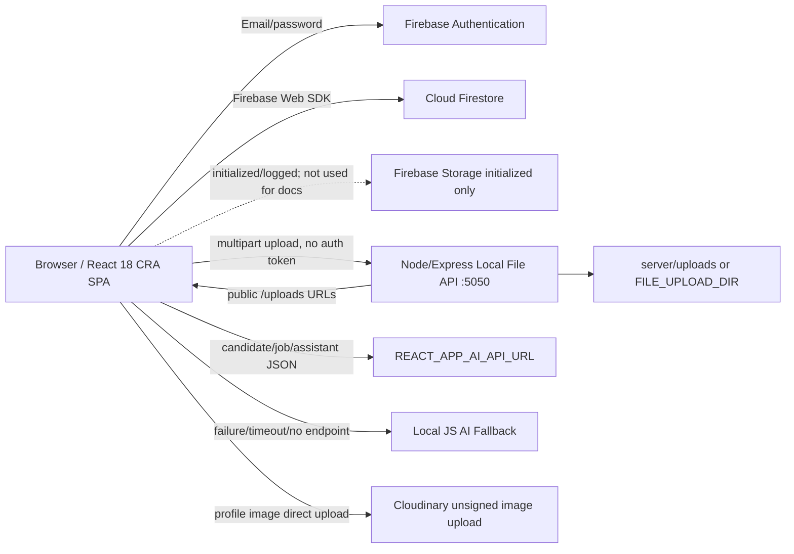
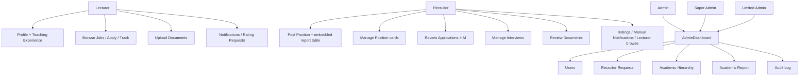
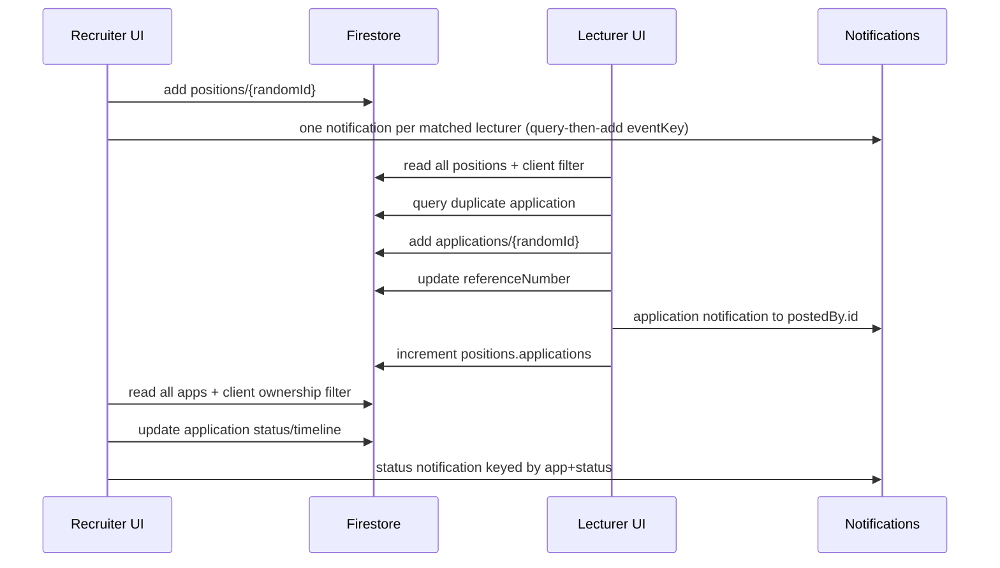
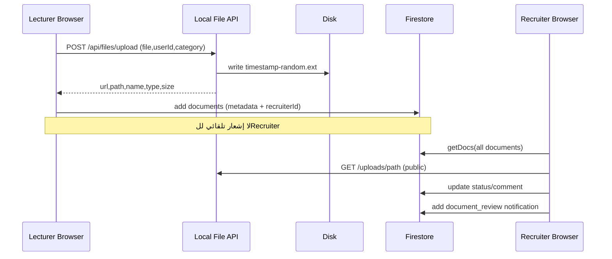
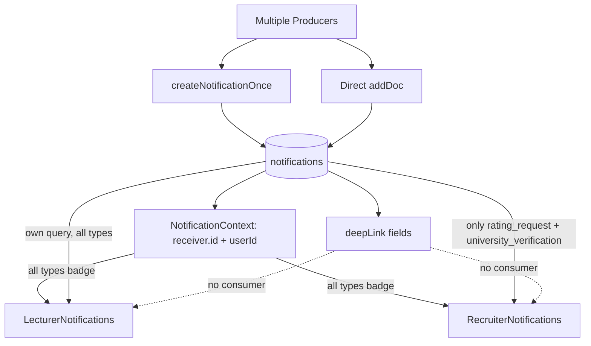

# Academia Smart — Architecture As-Is

**الغرض:** وصف البنية الفعلية الحالية فقط، لا البنية المستهدفة.  
**مرجع الكود:** `faculty-recruitment/` بتاريخ 2026-08-29.

## 1. Physical Structure

```text
Academia-Smart-v14-Consolidated-Fixes/
├─ package.json                     # حزمة جذرية غير قابلة للتشغيل؛ legacy
├─ START-ACADEMIA-SMART.bat         # ينتقل إلى faculty-recruitment ويشغل npm start
├─ src/                             # شظايا قديمة: Login + ملفان فارغان
└─ faculty-recruitment/             # التطبيق الفعلي
   ├─ public/                       # CRA shell + assets
   ├─ server/
   │  ├─ index.js                   # Express/Multer Local File API
   │  └─ uploads/                   # فارغ في النسخة المدققة
   ├─ src/
   │  ├─ components/
   │  │  ├─ auth/                   # login/signup/reset/route guard
   │  │  ├─ dashboard/              # role modules
   │  │  ├─ shared/                 # toast/dialog/uploader/assistant/language
   │  │  └─ system/                 # error/404/unauthorized
   │  ├─ context/                   # language + notification subscriptions
   │  ├─ firebase/                  # config + notification helpers
   │  ├─ locales/                   # ar/en JSON
   │  ├─ services/aiService.js      # Cloud-first + local candidate analysis
   │  └─ utils/                     # file upload/validation/labels
   ├─ firestore.rules               # rules source؛ deployment غير مثبت
   ├─ package.json / package-lock.json
   └─ docs/audit/                   # تقارير Phase 0 فقط
```

## 2. Runtime Topology



### Process startup

- `npm start` يشغّل `concurrently -k` لعمليتين: `node server/index.js` و`react-scripts start` (`package.json:21-27`).
- batch يثبت dependencies تلقائيًا إذا غاب `node_modules`، يحدد React port 3013، ويفتح المتصفح قبل readiness (`START-ACADEMIA-SMART.bat:3-10`).
- لا يوجد preflight لـ5050؛ `EADDRINUSE` يُسقط API، ومع `-k` قد تُقتل عملية الويب أيضًا.
- `server/index.js` لا يستورد `dotenv`؛ قيم `FILE_*` في `.env` لا تُقرأ تلقائيًا بواسطة عملية Node sibling.

## 3. Frontend Architecture

### Application shell

- `LanguageProvider` → `Router` → `NotificationProvider` → `ErrorBoundary` → routes + global `SmartAssistant` (`App.js:41-76`).
- BrowserRouter يتطلب server fallback إلى `index.html` للإنتاج، ولا توجد hosting config في المشروع.
- Firebase Auth/Firestore/Storage/Analytics تُهيأ مرة واحدة في `src/firebase/config.js`.

### Routes

| Route | الحماية | Component | ملاحظة |
|---|---|---|---|
| `/`, `/login` | public | Login | يوجه حسب `users.role`. |
| `/signup` | public | SignUp | ينشئ Lecturer Auth + users doc. |
| `/recruiter-signup` | public | RecruiterSignUp | ينشئ request فقط ويحفظ password حاليًا. |
| `/forgot-password` | public | ForgotPassword | Firebase reset email. |
| `/reset-password` | public | ResetPassword | يحتاج Firebase template action URL. |
| `/lecturer-dashboard` | Lecturer | LecturerDashboard | sections هي React state لا routes. |
| `/lecturer/notifications` | Lecturer | LecturerNotifications | route مستقل لنفس component. |
| `/lecturer/upload-documents` | Lecturer | UploadDocuments | route مستقل. |
| `/lecturer/ratings` | Lecturer | RequestRatings | route مستقل. |
| `/lecturer/recruiters` | Lecturer | ViewRecruiters | placeholder غير متصل بالبيانات. |
| `/recruiter-dashboard` | Recruiter | RecruiterDashboard | cards تُعرض داخليًا. |
| `/recruiter-dashboard/send-ratings` | Recruiter | SendRatings | يعتمد `location.state`; direct refresh يفقد lecturer. |
| `/admin-dashboard` | Admin | AdminDashboard | tab permissions داخل component. |
| `/unauthorized` | public | Unauthorized | صفحة ثابتة. |
| `*` | public | NotFound | 404 ثابتة. |

### State and data access

- لا توجد state library؛ كل component يستخدم local hooks.
- Firestore يُستدعى مباشرة من UI في كل module؛ لا repository/domain layer.
- بعض الشاشات realtime (`onSnapshot`)، وبعضها one-shot (`getDocs`) ولا تتحدث بعد تغييرات خارجية.
- لا schema validator أو TypeScript؛ الحقول والفئات strings موزعة بين components.
- error handling محلي وغير موحد؛ Toast في بعض المسارات وconsole-only في أخرى.

## 4. Role Flows



### Lecturer actual workflow

1. `SignUp` ينشئ Firebase Auth ثم `users/{uid}` بـrole lecturer.
2. Profile يحفظ بيانات نصية، skills، yearsExperience، وتجارب تدريسية تحوي IDs + snapshots.
3. ViewPositions يقرأ كل positions ثم يخفي paused/closed/archived فقط؛ draft غير مخفي.
4. Apply يتحقق client-side من profile وروابط CV ثم ينشئ application، reference number، notification، ويزيد counter.
5. TrackApplications يقرأ طلبات المستخدم ويعرض حالات محدودة.
6. UploadDocuments يرفع محليًا/يقبل URL ثم ينشئ document؛ لا notification للrecruiter.

### Recruiter actual workflow

1. RecruiterSignUp يقرأ universities active ديناميكيًا ويكتب recruiterRequest.
2. لا يوجد provisioning فعلي عند قبول الطلب.
3. Dashboard cards تتحكم بـ`activeComponent`؛ URL لا يتغير.
4. PostPosition ينشئ job/draft ويشعر lecturers؛ يوجد أسفله جدول «الوظائف التي أنشأتها».
5. ManagePositions يقدم cards للتعديل/status/copy ويحسب applicants من applications.
6. ViewApplications يفلتر client-side applications التي تعود إلى positions الخاصة به ويعرض AI.
7. ManageInterviews يحمّل كل collections ثم يفلتر client-side حسب recruiter.
8. ReviewDocuments يحمّل كل documents بلا `recruiterId` filter.

### Admin/Super/Limited actual workflow

- `ProtectedRoute` يتحقق من role/status ويمكنه permission إذا مُررت، لكن admin route يمرر role فقط.
- AdminDashboard يقرأ current admin ثم يخفي tabs حسب permissions.
- legacy admin بلا `adminLevel/permissions` يُعامل Super في UI.
- أغلب الأفعال تعتمد Firestore Rules وليس guard محليًا؛ بعض super-only functions تفحص `isSuperAdmin`.
- `jobs.view` permission لا تقابل tab/feature إدارية حالية.

## 5. Recruitment Flow



لا توجد transaction تجمع العمليات، لذلك يمكن حدوث partial completion: application بلا notification/counter، أو status بلا notification.

## 6. Document Flow



- لا versioning أو delete endpoint أو checksum.
- document review notification يذكر `document.title` بالفعل.
- legacy URLs يمكن أن تشير إلى ملفات غير موجودة؛ لا migration/friendly preview handler.

## 7. Notification Flow



- Producers باستخدام helper: new job، new application، application status، interviews.
- Direct producers: document review، manual notification، rating flows، course verification، recruiter interest.
- `eventKey` ليس idempotency ذريًا؛ هو query ثم add.
- `read` و`status` غير مفصولين دائمًا.

## 8. AI Architecture

- Candidate analysis: browser يرسل application إلى endpoint؛ timeout 9s ثم local.
- Job description: browser يرسل position؛ timeout 7s ثم template محلي.
- Smart Assistant: role من users doc + pathname + static KB؛ cloud timeout 7s ثم lexical local match.
- لا backend AI داخل المشروع، لا API auth contract، ولا model governance.
- AI لا يكتب قرارات التوظيف آليًا؛ النتيجة تعرض كمؤشر مساعد.

## 9. Reporting Architecture

- Academic Report وRecruiter Jobs Report يبنيان HTML string في browser، يفتحان `about:blank` ثم `window.print()`.
- «PDF» تعني اختيار Save as PDF من native print dialog، وليست PDF generation library.
- لا CSV/Excel library أو export implementation.
- Audit Log لا يملك export.

## 10. Architectural Constraints Observed

- Backend الوحيد files؛ كل business mutations من untrusted browser.
- Firebase Admin SDK/Cloud Functions غير موجودة.
- لا shared domain schema أو canonical enums.
- لا automated tests تغطي business/security.
- لا deployment manifests/indexes.
- dashboard-as-component-state يمنع deep links، refresh restoration، وpage-aware assistant الدقيق.
