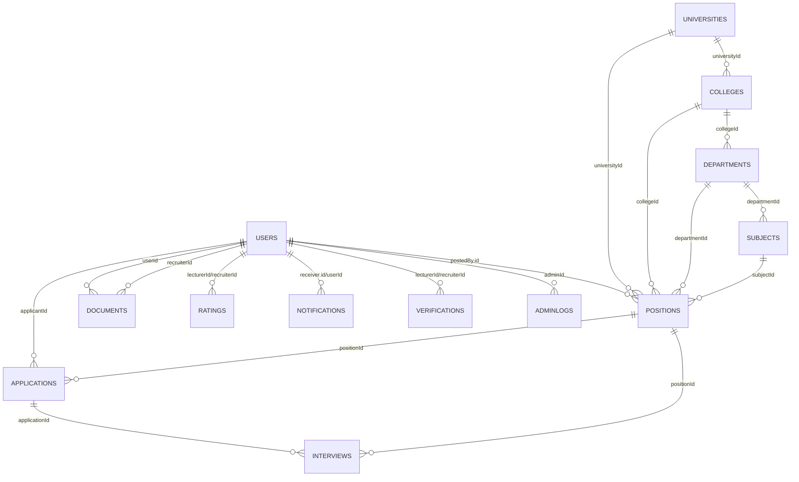

# Academia Smart — Data Model As-Is

**المصدر:** استقراء جميع قراءات/كتابات Firestore في الكود الحالي. لا يوجد schema رسمي أو export لبيانات Firestore الحية. الحقول التالية هي union لما يتوقعه/يكتبه التطبيق، وليست ضمانًا أن كل مستند حي يحتويها.

## Overview

## ID Strategy

- `users/{uid}`: Firebase Auth UID.
- بقية collections: `addDoc` random Firestore IDs.
- `applications.referenceNumber`: `APP-YYYY-<first 8 chars of random ID>`؛ fallback UI `APP-<8 chars>` بلا year.
- `notifications.eventKey`: business string اختياري، لكنه ليس document ID ولا unique constraint.
- Local file path: `<sanitized userId>/<sanitized category>/<timestamp>-<16 hex>.<ext>`.
- لا document IDs deterministic للقيود الفريدة مثل application(position,user) أو eventKey.

## Collections / Entities

### `users/{uid}`

| Field | النوع/القيم | مصدر/استخدام |
|---|---|---|
| firstName, lastName | string | signup/profile/admin/denormalization |
| email | string | signup/admin; غالبًا snapshot من Auth |
| phoneNumber | string | Lecturer signup/profile |
| phone | string | Admin editor فقط؛ حقل منافس لـphoneNumber |
| profilePicUrl | string | Cloudinary URL |
| role | lecturer/recruiter/admin | auth routing/RBAC |
| accountStatus | active/suspended/blocked أو absent | login/route/rules |
| adminLevel | super/limited أو absent | Admin RBAC |
| isSuperAdmin | boolean legacy | Admin RBAC |
| permissions | string[]، قد تحوي `*` | Limited Admin |
| createdAt | ISO string أو Timestamp | غير موحد |
| createdBy | uid | إنشاء limited admin |
| updatedAt | Timestamp | admin updates أحيانًا |
| university, department | string legacy/display | recruiter/profile/verification matching |
| universityId, departmentId | string متوقع جزئيًا | jobs matching؛ لا يكتبها lecturer main profile حاليًا |
| collegeId, subjectIds | string / string[] متوقعة جزئيًا | jobs matching |
| education | string | application snapshot/AI |
| cvUrl, certificatesUrl | URL | profile/application snapshot |
| skills | string[] | profile/application snapshot/AI |
| yearsExperience | string/number-like | profile/application snapshot |
| teachingExperience | embedded array | academic history/verification/AI |

#### `teachingExperience[]`

`universityId`, `collegeId`, `departmentId`, `subjectId`, إضافة إلى snapshots النصية `university`, `department`, `course`; و`description`, `opinion`, `rating`, `verificationStatus`, `verified`, `verifiedBy`, `verificationId`, `otherCourse`.

**مخاطر:** array index يُستخدم لربط verification؛ حذف/إعادة ترتيب العناصر يجعل index غير ثابت. الحقول النصية والـIDs قد تتعارض. المستخدم يستطيع تحديث users doc مباشرة وفق Rules الحالية.

### `recruiterRequests/{requestId}`

| Field | النوع/القيم |
|---|---|
| firstName, lastName, email | string |
| password | **plaintext string — خطر P0** |
| university | string snapshot |
| universityId | document ID |
| profilePicUrl | string |
| status | pending/approved/rejected |
| createdAt | Timestamp |
| processedAt | ISO string |

لا يوجد `processedBy`, `provisionedUid`, `failureCode`, `attemptId`, أو state machine. Approved لا يعني وجود account.

### `universities/{id}`

`name`, `active`, `createdAt`, `updatedAt`.

### `colleges/{id}`

`name`, `universityId`, `active`, `createdAt`, `updatedAt`.

### `departments/{id}`

`name`, `collegeId`, `active`, `createdAt`, `updatedAt`.

### `subjects/{id}`

`name`, `departmentId`, `code`, `active`, `createdAt`, `updatedAt`.

**Academic hierarchy risks:**

- uniqueness/code generation client-side فقط وغير ذري.
- لا bilingual fields (`nameAr/nameEn`)؛ الاسم data raw.
- parent snapshot غير موجود داخل child؛ report يجمع client-side.
- delete protection في UI يفحص بعض child/position relations فقط.

### `positions/{positionId}`

| Field | النوع/القيم |
|---|---|
| title, description, requirements, contactEmail | string |
| institution | university name snapshot |
| universityId, collegeId, departmentId, subjectId | IDs |
| college, department, subject, subjectCode | snapshots |
| type | `Full-time`, `Part-time`, `Contract` ونحوها |
| employmentType | `full-time`, `part-time`؛ يكتبه ManagePositions |
| deadline | `YYYY-MM-DD` string |
| status | open/draft/paused/closed/archived |
| postedBy | `{id,email,name}` |
| postedDate | ISO string |
| applications | number denormalized counter |
| createdAt, updatedAt | Timestamp |

**مخاطر:** `type`/`employmentType` منافسان؛ counter قد ينحرف؛ academic names تصبح stale؛ draft readable/visible للlecturer حاليًا.

### `applications/{applicationId}`

| Field | النوع/القيم |
|---|---|
| positionId, applicantId | IDs الأساسية |
| positionTitle, institution, college/department/subject/code | job snapshots |
| collegeId/departmentId/subjectId | academic IDs جزئية |
| applicantName, applicantEmail | user snapshots |
| education, experience, teachingExperience, skills | candidate snapshots |
| cvUrl, certificatesUrl | document URL snapshots |
| requirements | job requirements snapshot |
| status | pending/under_review/interview_scheduled/under_evaluation/approved/rejected؛ historical `accepted` مدعوم جزئيًا |
| referenceNumber | generated string |
| appliedDate | ISO string |
| timeline | embedded array of status/label/note/at/actorId |
| decisionNote, recruiterNotes | strings |
| updatedAt | Timestamp |
| recruiterId | **متوقع في UploadDocuments لكنه لا يُكتب عند application creation** |

**مشكلة علاقة مؤكدة:** `UploadDocuments` يجمع approved recruiter IDs من `application.recruiterId`، لكن `ViewPositions` لا يحفظ `recruiterId`; لذا badge/filter “approved recruiter” قد لا يعمل للطلبات الجديدة.

### `interviews/{interviewId}`

`applicationId`, `positionId`, `positionTitle`, `candidateId`, `candidateName`, `candidateEmail`, `recruiterId`, `date`, `time`, `scheduledAt`, `type` (`online`/`in-person`), `location` (meeting URL أو مكان), `status` (`scheduled/rescheduled/completed/cancelled/no_show`), `createdAt`, `updatedAt`.

**Legacy fields:** بعض السجلات تفتقد `positionTitle`/`applicationId`/candidate snapshots، فتظهر fallback labels. لا duration/timezone/scorecard.

### `documents/{documentId}`

`userId`, `userName`, `userEmail`, `recruiterId`, `recruiterName`, `title`, `type`, `department`, `fileURL`, `storagePath`, `fileName`, `fileType`, `fileSize`, `uploadedAt` (ISO), `status` (`pending/approved/rejected`), `reviewedAt` (ISO/null), `reviewerComments`.

**مفقود:** applicationId، version/previousVersionId، checksum، uploadedAt Timestamp، reviewerId، file provider canonical field، missing-file state.

### `notifications/{notificationId}`

الاتفاق غير موحد. union الحقول:

- routing: `userId`, `receiver.id`, legacy `receiverId`.
- sender: embedded `sender`, legacy `senderId/senderName`.
- content: `type`, `title`, `message`.
- read state: `read`, `status` أحيانًا unread/read.
- business state: `status` أيضًا pending/accepted/rejected/approved، إضافة إلى `reviewStatus`, `applicationStatus`, `interviewStatus` أحيانًا.
- links: `deepLink`, `relatedId`, `positionId`, `applicationId`, `interviewId`, `documentId`, `verificationId`.
- idempotency: `eventKey` لبعض المنتجين فقط.
- audit: `createdAt`, `updatedAt`, `readAt`, `actionTakenBy`.

**Types المرصودة:** `new_position`, `application`, `application_status`, `interview`, `interview_rescheduled`, `interview_status`, `document_review`, `rating_request`, `rating_received`, `recruiter_interest`, `course_verification`, `university_verification` (consumer), وأنواع manual `general/document/interview/rating`.

### `ratings/{ratingId}`

`lecturerId`, `lecturerName`, `lecturerEmail`, `recruiterId`, `recruiterName`, `recruiterEmail`, `rating`, `feedback`, `createdAt`.

لا applicationId/jobId، لا unique business key، ولا link إلى rating_request؛ يمكن تكرار ratings.

### `verifications/{verificationId}`

`type: course_verification`, `status`, lecturer/recruiter IDs/names/emails، `university`, `department`, `course`, `description`, `opinion`, `rating`, `experienceIndex`, `createdAt`, `read`.

الـnotification يحمل verificationId، لكن consumer الحالي يبحث نوعًا آخر ويعدّل `users.teachingExperience[experienceIndex]` مباشرة. لا update لـverification document ظاهر في consumer.

### `adminLogs/{logId}`

`action`, `target`, `details` (غالبًا JSON string)، `adminId`, `createdAt`.

**مخاطر:** target غالبًا ID، لا actor snapshot/email/role/IP، details غير typed، الكتابة client-side، إنشاء log منفصل عن الفعل وقد يفشل بصمت.

## Denormalization Map

| المصدر المرجعي | snapshots المكررة |
|---|---|
| users | applications applicantName/email/profile data؛ documents user/recruiter names؛ notifications sender/receiver؛ ratings؛ interviews |
| academic hierarchy | positions names/code؛ applications names/code؛ users teachingExperience text |
| positions | applications positionTitle/requirements/institution؛ interviews positionTitle؛ notifications title |
| applications | interviews candidate/job snapshots؛ status notifications |
| local file | Firestore URL/path/name/type/size مقابل الملف الفعلي على disk |

Denormalization يفيد التاريخ، لكنه بلا سياسة واضحة: بعض snapshots ينبغي أن تبقى تاريخية، وبعض الشاشات تتوقع live names. يجب تحديد canonical/live/history لكل حقل قبل migration.

## Orphan Risks

- Auth user بلا `users/{uid}` عند partial signup/admin creation.
- approved recruiterRequest بلا Auth/users account (مؤكد حاليًا).
- users doc بلا Auth user بعد حذف خارجي.
- application يشير إلى position/user محذوف أو legacy ID.
- interview يشير إلى application/position مفقود.
- document يشير إلى recruiter/user مفقود أو local file غير موجود.
- notification يشير إلى target مفقود أو receiver field legacy.
- verification يشير إلى array index تغير.
- academic child بلا parent؛ Admin health يفحص هذه الثلاث علاقات فقط.
- Firestore local file reference بلا physical file؛ `server/uploads` فارغ في هذه الحزمة.

## Historical Compatibility

- Admin legacy بلا `adminLevel/permissions` يُعامل Super في UI فقط.
- applications تستخدم `accepted` و`approved` تاريخيًا.
- notifications تستعمل `receiver.id`, `userId`, `receiverId`.
- timestamps مختلطة Timestamp/ISO/legacy `timestamp`.
- academic data مختلطة text-only وIDs.
- file URLs مختلطة Firebase Storage/Cloudinary/local/external URL حسب changelogs.
- positions تستخدم `type` و`employmentType`.
- profile phone `phoneNumber` مقابل Admin `phone`.

## Recommended Migration Notes — لا تنفيذ في Phase 0

1. جرد حي read-only مع counts/schema frequency/orphans، وتصدير backup محلي عند checkpoint المصرح.
2. إزالة plaintext password من requests فورًا مع secret rotation/incident review قبل أي migration واسع.
3. تعريف canonical schemas وenums/version field لكل entity.
4. إنشاء stable business IDs/unique docs: application `${positionId}_${applicantId}` وnotification event document أو idempotency ledger.
5. فصل notification `readState` عن `businessStatus`، وتوحيد receiver/target.
6. إضافة `recruiterId` إلى applications من position owner، مع backfill قابل للتحقق.
7. توحيد `employmentType`, statuses, timestamps، والهاتف.
8. بناء manifest للملفات: storagePath/provider/checksum/existence؛ لا حذف مراجع أو ملفات أثناء الاكتشاف.
9. backfill interview titles من application/position مع الاحتفاظ بالسnapshot التاريخي.
10. استبدال experienceIndex بـexperienceId ثابت قبل verification migration.
11. إضافة schemaVersion وmigration ledger؛ كل batch idempotent وله dry-run/report/rollback.
12. لا تُغيّر historical display snapshots بلا سياسة موثقة؛ يمكن إضافة live resolved fields بدل overwrite.
